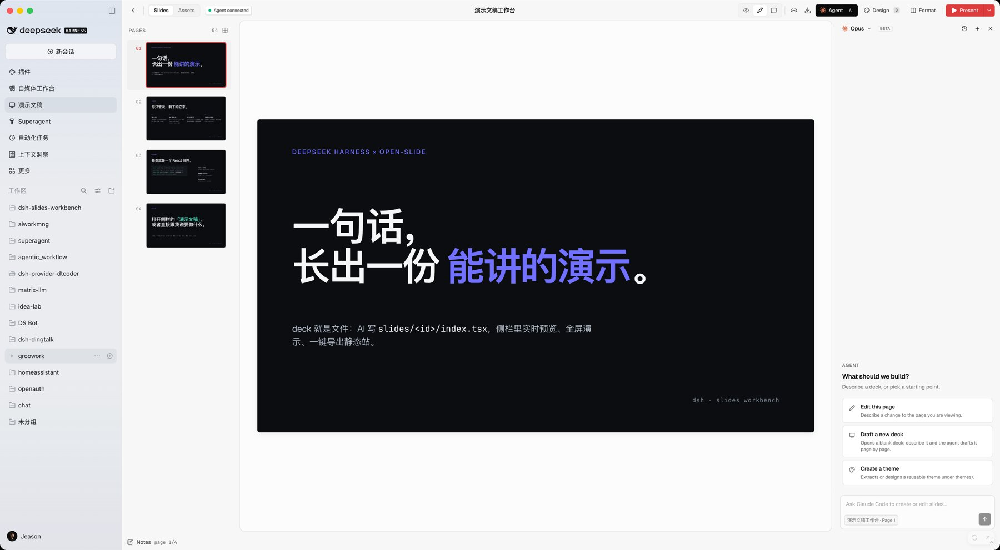
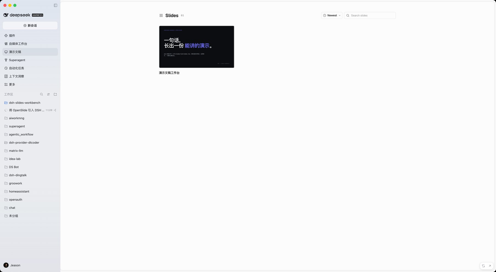

# 演示文稿工作台 · dsh-slides-workbench

<p align="center"><b>DeepSeek Harness 的一个插件。侧栏里直接打开 <a href="https://open-slide.dev/docs">open-slide</a> 的演示文稿工作台：AI 写页面，你在它自己的编辑器里看、改、讲、导出。</b></p>



<sub>面板里就是 open-slide 本尊：左侧页面缩略图、中间 1920×1080 画布、右侧 Format / Agent 面板、右上角 Present / Design / Export。</sub>

<br>

## 它是什么

插件做三件事，不多也不少：

1. **准备一个真正的 open-slide 工作区** —— 装好插件就自动创建 `$DSH_HOME/slides-workbench`，装一次 `@open-slide/core`。不需要点「初始化」。
2. **把 open-slide 的页面搬进 DSH** —— 侧栏「演示文稿」打开就是 open-slide 自己的界面：deck 列表、编辑器、inspector、素材、演示模式、导出菜单。**插件不重画任何 deck UI**，只在它起来之前显示一句「正在准备」。

   首页那圈属于 open-slide 自己的左侧导航（Slides / Themes / Assets / FOLDERS）会被隐藏掉，只留右侧内容；进到某个 deck 之后，编辑器的页面缩略图列照常保留。做法是 Host 把 dev server 挂在 DSH 的同源路径 `/slides-workbench/app/` 下反代（含 HMR WebSocket 和 `/__*` 接口），iframe 与面板同源，再注入一小段 CSS。

   **外观和语言跟随 DSH 外壳**：同源还让面板能直接改 iframe 里的文档——DSH 切明/暗时把
   `html.dark` 同步进 open-slide（实时，不刷新）；DSH 切语言时写 open-slide 自己的
   `open-slide:locale`（`zh-CN` / `en`）并让它重载一次。所以不需要在两边各调一遍。
3. **把「做 deck」这件事交给 agent** —— 注册 8 个 `slides_*` 工具和 2 个 skill，模型在会话里就能建 deck、写页面、写讲稿、构建导出。

打开面板先是工作台**首页**：中间一个输入框，说一句「帮我做一个关于 X 的演示」，它会新建 deck、
开好 DSH 对话并直接进编辑器；周围一圈是最近的 deck 预览卡片（固定轨道，不做无限拖拽），
点一张就进去。右下角「浏览全部幻灯片」进 open-slide 自己的列表页。



<sub>点开「演示文稿」首先是 open-slide 的 deck 浏览页：`+ New deck`、卡片、搜索、Newest 排序都是它自己的功能，只是左边那列导航没有了。</sub>

<br>

## 安装

在 DeepSeek Harness 的「插件」页里安装，或者让 AI 执行：

```
plugin_manager install_bundle  →  target: <本仓库的绝对路径>
```

装好后侧栏出现「演示文稿」图标。**第一次装完插件就已经在准备了**：插件激活时会自己
写工作区模板、`npm install` 装依赖，面板里能看到进度；装完直接出 open-slide 的页面。

> 需要本机有 Node 20+ 和可用的 npm 源（只有第一次准备要联网，之后可以离线用）。
> 依赖装在 `$DSH_HOME/slides-workbench/node_modules`，不碰你的项目目录。

<br>

## 装好之后怎么用

**在面板里**：和用 open-slide 网页版一模一样。

- 首页是 deck 卡片；点进去是编辑器，点元素能改样式，右侧 Format / Design 面板直接改源文件。
- 右上角 `Present` 进全屏演示（方向键 / 空格翻页，`p` 开 presenter view，讲稿在旁边）。
- 右上角导出菜单出 HTML / PDF / PPTX；`dist/` 静态站可以直接部署。
- 面板右下角有两个小按钮：重新加载页面、在浏览器里单独打开（同一台机器时很顺手）。

**编辑器里的 Agent 面板**：已经只接 DSH。

open-slide 自带的 agent provider 只有 Claude Code / Codex（硬编码走各自 CLI）。插件把
`/__agent/*` 整段接管，改成 DSH 后端：

- 面板里显示的唯一 provider 是 **DeepSeek Harness**，模型下拉是「当前会话的模型」；
- 新建一个 open-slide 对话 = 在 DSH 里新建一个会话（cwd 是工作区），所以它同时出现在侧栏，
  可以点开继续聊、也能被搜索到；
- 面板里的提问会写进那个 DSH 会话，并自动带上工作台上下文（当前 deck、第几页、选中的元素、
  待处理批注），模型用 `slides_*` 工具改页面；
- 面板里的「停止」= 打断那一轮；每一轮的 user / 助手 / 工具调用 / 结果都会翻译成 open-slide
  的 item 显示出来（工具调用和回复文字都是**边做边显示**，走 DSH 的 token 流）；
- 右上角的模型下拉就是 DSH 当前可路由的真实模型，选了就落到这个会话上（`selectModel`）；
- 模型问你问题时，面板里出现的是**可点的选项**（`user-questions/request` 被接管），点完答案
  直接回填给工具，不用切回 DSH；
- 你在面板里再发一句时不会报「忙」，而是用 `agent.steer()` 插到当前这轮的下一步；
- 每次发消息都会读一遍 open-slide 的 `current.json`，所以"这一页 / 选中了什么"始终是最新的；
- provider 的图标（open-slide 写死的 Claude / OpenAI 品牌 SVG）已经换成工作台自己的图标。

**在会话里**：直接说

> 帮我做一个关于灰度发布的演示，8 页，深色、克制，带讲稿。

模型会先读 `slides-authoring` skill（open-slide 的 1920×1080 画布、页面契约、动效原语、反模式），
再调工具落盘，面板里的 open-slide 会自动热更新。

| 工具 | 用途 |
| --- | --- |
| `slides_status` | 工作区路径、依赖状态、dev server 地址、deck 列表摘要 |
| `slides_list` | 列出 deck（id / 标题 / 页数 / 更新时间） |
| `slides_read_deck` | 读某个 deck 的 `index.tsx` 全文 |
| `slides_create_deck` | 新建 deck（kebab-case id + 一页封面） |
| `slides_write_deck` | 覆盖写 `index.tsx`，写前校验（默认导出非空、讲稿按页对齐） |
| `slides_delete_deck` | 删除（移到工作区 `.trash/`） |
| `slides_present` | 确保 dev server 在跑，给预览 / 编辑器地址 |
| `slides_build` | 构建静态站到 `dist/` |

两个 skill：`slides-authoring`（页面写作技术参考）、`slides-create-deck`（从零做一份 deck 的工作流）。

<br>

## 配置

插件行配置（`cordis.patch.yml` 里的 `config`）：

```yaml
- insert:
    - id: slides-workbench
      name: 'dsh-slides-workbench'
      config:
        workspace: ~/Documents/decks   # 工作区位置，默认 $DSH_HOME/slides-workbench
        port: 5173                     # open-slide dev server 起始端口，占用时自动 +1
```

<br>

## 数据在哪

- 工作区：默认 `~/.dsh/slides-workbench`
  - `slides/<id>/index.tsx` —— deck 源码（就是文件，随便 git 管理）
  - `slides/<id>/assets/` —— 这个 deck 的图片 / 视频 / 字体
  - `themes/` —— 跨 deck 复用的设计系统
  - `dist/` —— `slides_build` 的产物
  - `.trash/` —— 删掉的 deck 留在这里，可以手动捞回
- 会话：编辑器里发起的每段对话都是 DSH 自己的会话（侧栏可见，cwd 指向这个工作区）。
- 插件不写别的地方，不需要账号或 API key：写页面用的是当前会话的模型，dev server 是本机进程。

<br>

## 常见问题

**面板一直显示「正在准备工作台」？** 看下面的安装日志。多半是 npm 源不通；修好网络后点一下「继续准备」。
日志会显示到底卡在哪一行。

**显示「正在启动演示服务」或者报错？** 点「重新启动」。dev server 只监听 `localhost`；
如果端口被别的 Vite 占了，插件会自动往后找一个空闲端口，日志里能看到实际端口。

**页面白屏 / 有一行红字？** 那是 `index.tsx` 真的错了 —— open-slide 把错误画在画布上。把错误贴给 AI 让它改。

**Agent 面板报错「当前 profile 缺少会话服务」？** 说明这个 profile 没装 DSH 的会话服务（极少见），
面板会明确报出来而不是假装能用；此时仍然可以在 DSH 输入框里让 AI 改 deck。

**能脱离 DSH 用吗？** 能。工作区就是标准 open-slide workspace，只是为了让面板嵌入，
`open-slide.config.ts` 里的 `base` 指向 `/slides-workbench/app/`：
`cd ~/.dsh/slides-workbench && npm run dev` 之后打开 <http://localhost:5173/slides-workbench/app/>。
`slides_build` 会在构建时临时把 base 换回 `/`，所以 `dist/` 依然可以部署到任何静态托管的根路径。
这个配置文件由工作台维护，**不要手改**。

**远程用 DSH 时？** 面板里的 iframe 走的是 DSH 自己的同源路径（Host 上的反代），所以远程访问
DSH 也能看到 open-slide 页面；dev server 仍然只跑在 Host 上、只听 localhost。

<br>

## 依赖与致谢

- [open-slide](https://open-slide.dev/docs)（MIT，© Yiwei Ho）——deck 运行时、编辑器、inspector、
  present 模式、导出、以及 agent skills 的上游。插件不重新实现它们，只负责在本机把工作区和
  dev server 管起来，并把页面嵌进 DSH。
- DeepSeek Harness 的 slot / webServer / tools / skills / systemPrompt 服务。

## License

MIT