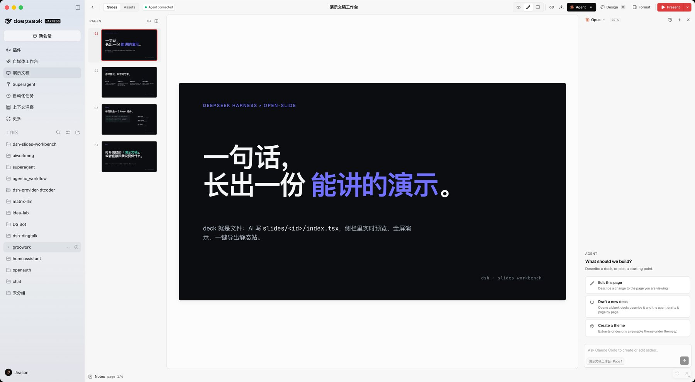
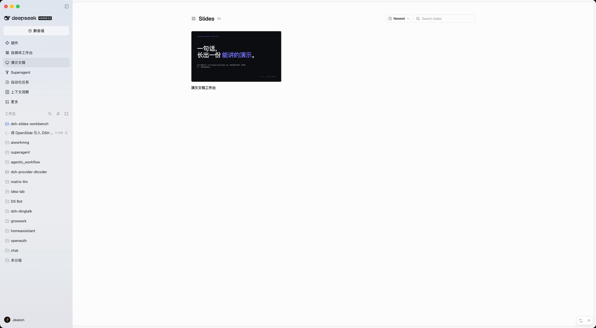

# 演示文稿工作台 · dsh-slides-workbench

<p align="center"><b>DeepSeek Harness 的一个插件。侧栏里直接打开 <a href="https://open-slide.dev/docs">open-slide</a> 的演示文稿工作台：AI 写页面，你在它自己的编辑器里看、改、讲、导出。</b></p>



<sub>面板里就是 open-slide 本尊：左侧页面缩略图、中间 1920×1080 画布、右侧 Format 面板、右上角 Present / Design / Export。</sub>

<br>

## 它是什么

插件做三件事，不多也不少：

1. **准备一个真正的 open-slide 工作区** —— 装好插件就自动创建 `$DSH_HOME/slides-workbench`，装一次 `@open-slide/core`。不需要点「初始化」。
2. **把 open-slide 的页面搬进 DSH** —— 侧栏「演示文稿」打开就是 open-slide 自己的界面：deck 列表、编辑器、inspector、素材、演示模式、导出菜单。**插件不重画任何 deck UI**，只在它起来之前显示一句「正在准备」。

   首页那圈属于 open-slide 自己的左侧导航（Slides / Themes / Assets / FOLDERS）会被隐藏掉，只留右侧内容；进到某个 deck 之后，编辑器的页面缩略图列照常保留。做法是 Host 把 dev server 挂在 DSH 的同源路径 `/slides-workbench/app/` 下反代（含 HMR WebSocket 和 `/__*` 接口），iframe 与面板同源，再注入一小段 CSS。

   **外观和语言跟随 DSH 外壳**：同源还让面板能直接改 iframe 里的文档——DSH 切明/暗时把
   `html.dark` 同步进 open-slide（实时，不刷新）；DSH 切语言时写 open-slide 自己的
   `open-slide:locale`（`zh-CN` / `en`）并让它重载一次。所以不需要在两边各调一遍。
3. **把「做 deck」这件事交给 agent** —— 带一个 `slides-workbench` agent preset（DSH standard 预设 + open-slide 官方技能），工作台里的对话都用它，直接在工作区里建 deck、写页面、写讲稿。这些技能只在工作台的对话里出现，不打扰其他 DSH 会话。

打开面板先是工作台**首页（灵感墙）**：中间一句话 + 输入框，说一句「帮我做一个关于 X 的演示」，
它会新建 deck、打开编辑器（Agent 面板开着），并把需求发进 Agent 面板里的 DSH 对话。

- **卡片填充需求**：周围散落着打包在插件里的灵感卡（和本地 deck 无关）。点封面卡或想法卡，内容「打」进输入框；
  心法卡和配色卡作为风格要求叠加在需求后面（输入框下方的小标签），按退格键移除最后一个。
- **画布**：可拖动平移、滚轮滚动、⌘/Ctrl + 滚轮缩放；右下角缩小 / 回到中心 / 放大。窄面板时退回两列文档流。
- **底部 dock**：按类型筛选卡片、「手气不错」随机挑一张、「模板」进 open-slide 的主题页、「我的演示」进 deck 列表。
- **模板**：模板详情页右上角多一个「用这个模板」，点了回首页、把这个主题挂成叠加项。
  插件内置 11 套汉化的官方模板（`themes/`），启动时和打开模板页时合并进工作区的 `themes/`：
  改过或删掉的官方模板、与官方同名的本地模板都不会被覆盖，此后也不再同步（记录在 `themes/.official.json`）。



<sub>点开「演示文稿」首先是 open-slide 的 deck 浏览页：`+ New deck`、卡片、搜索、Newest 排序都是它自己的功能，只是左边那列导航没有了。</sub>

<br>

## 安装

在 DeepSeek Harness 的「插件」页里安装，或者让 AI 执行：

```
plugin_manager install_bundle  →  target: <本仓库的绝对路径>
```

装好后侧栏出现「演示文稿」图标。**第一次装完插件就已经在准备了**：插件激活时会自己
写工作区模板、`npm install` 装依赖，面板里能看到进度；装完直接出 open-slide 的页面。

> 需要本机有 Node 20+ 和可用的 npm 源（只有第一次准备要联网，之后可以离线用）。
> 依赖装在 `$DSH_HOME/slides-workbench/node_modules`，不碰你的项目目录。

<br>

## 装好之后怎么用

**在面板里**：和用 open-slide 网页版一模一样。

- 「我的演示」里是 deck 卡片；点进去是编辑器，点元素能改样式，右侧 Format / Design 面板直接改源文件。
- 右上角 `Present` 进全屏演示（方向键 / 空格翻页，`p` 开 presenter view，讲稿在旁边）。
- 右上角导出菜单出 HTML / PDF / PPTX；`dist/` 静态站可以直接部署。
- 面板右边缘竖排几个小按钮：回到首页、重新加载页面、在访达中显示工作区、在浏览器里单独打开当前页（同一台机器时很顺手）。

**编辑器里的 Agent 面板：外壳是 open-slide 的，内容是 DSH 原生对话。**

工具栏的 **Agent** 按钮、快捷键 `A`、「…」菜单里的入口、右侧停靠栏的开合与拖宽，都是 open-slide 自己的；
面板里面换成了 DSH 的原生对话流和输入框（流式输出、工具调用、提问选项、审批、插话、模型选择、上下文用量都是 DSH 的），
插件不自己画对话，也不再接管 open-slide 的 `/__agent` 接口（它自带的 agent 后端在 `open-slide.config.ts` 里关掉了）。

- 每个 deck 一段 DSH 会话，标题是 deck 标题，归在 DSH 的 `slides-workbench` Workspace 下（cwd 就是工作区），
  所以在 DSH 侧栏里同样能看到、继续、搜索；
- 面板标题栏：「+」给这个 deck 开一段新对话，「×」关掉面板（和点 Agent 按钮一样）；
- 打开面板就是这个 deck 的对话（之前聊过就接着显示；没聊过也不显示 DSH 的欢迎页，直接是消息区 + 贴底的输入框）；
- 外观跟 open-slide 的面板走：配色（面板底色、用户消息、输入框、发送按钮）、字体与字号（12.5px · 1.5）、圆角（8px / 5px）、
  边距（消息区 16px、输入框 12px）都用 open-slide 的规范，明暗切换时实时跟随；面板默认宽度和 Format / Design 一样（320px），拖过之后记住；
- 首页提交需求 = 新建 deck、进编辑器时 Agent 面板开着，需求作为第一条消息发进这个 deck 的对话；
- 「这一页 / 选中的这个」由模型读 open-slide 的 `node_modules/.open-slide/current.json`（`current-slide` skill）。

**模型侧：`slides-workbench` agent preset**

Agent 面板里的每段对话都用插件自带的 `slides-workbench` 预设建（在 DSH 的预设列表里叫「演示文稿工作台」，
不用手动选）。它是 DSH standard 预设的拷贝，只多了 open-slide 的技能；会话 cwd 就是工作区，模型用普通文件工具
直接写 `slides/<id>/index.tsx`，规则来自工作区的 `AGENTS.md`。比如在 Agent 面板里说

> 帮我做一个关于灰度发布的演示，8 页，深色、克制，带讲稿。

模型会先读 `slide-authoring` skill（open-slide 的 1920×1080 画布、页面契约、动效原语、反模式），
再写文件，面板里的 open-slide 自动热更新；新建的 deck 几秒内出现在列表里。

> 改用预设之前建的 deck 对话跑的是 standard，没有这些技能，打开时会自动给这个 deck 换一段新对话（旧的仍在 DSH 侧栏里）。
> 在普通 DSH 会话里不再有做 deck 的工具和技能，请到工作台里做。

5 个 skill 是 open-slide 官方技能（`skills/`，与上游的差异见 `skills/README.md`）：`slide-authoring`（页面写作技术参考）、
`create-slide`（从零做 deck）、`create-theme`（做主题）、`apply-comments`（处理编辑器里的批注）、`current-slide`（「这一页」指的是哪）。

<br>

## 配置

插件行配置（`cordis.patch.yml` 里的 `config`）：

```yaml
- insert:
    - id: slides-workbench
      name: 'dsh-slides-workbench'
      config:
        workspace: ~/Documents/decks   # 工作区位置，默认 $DSH_HOME/slides-workbench
        port: 5173                     # open-slide dev server 起始端口，占用时自动 +1
```

<br>

## 数据在哪

- 工作区：默认 `~/.dsh/slides-workbench`
  - `slides/<id>/index.tsx` —— deck 源码（就是文件，随便 git 管理）
  - `slides/<id>/assets/` —— 这个 deck 的图片 / 视频 / 字体
  - `themes/` —— 跨 deck 复用的设计系统
  - `dist/` —— 导出静态站的产物
  - `.trash/` —— 删掉的 deck 留在这里，可以手动捞回
- 会话：编辑器里发起的每段对话都是 DSH 自己的会话（侧栏可见，cwd 指向这个工作区）。
- 插件不写别的地方，不需要账号或 API key：写页面用的是当前会话的模型，dev server 是本机进程。

<br>

## 常见问题

**面板一直显示「首次使用，正在安装 open-slide…」？** 依赖按 `template/package-lock.public.json` 用 `npm ci` 安装，
依次尝试 npmmirror、npmjs，装完会实际加载一遍原生绑定。失败时画面上有「重试」和可展开的安装日志，日志会显示到底卡在哪一行。

**「预览没能启动」？** 点「重试」。dev server 只监听 `localhost`；
如果端口被别的 Vite 占了，插件会自动往后找一个空闲端口，日志里能看到实际端口。

**页面白屏 / 有一行红字？** 那是 `index.tsx` 真的错了 —— open-slide 把错误画在画布上。把错误贴给 AI 让它改。

**Agent 面板显示「当前 DSH 没有会话服务」？** 说明这个 profile 没装 DSH 的会话界面（极少见）；
工作台其它功能照常，可以在 DSH 里新建一个选「演示文稿工作台」预设、目录是工作区的会话，让 AI 改 deck。

**能脱离 DSH 用吗？** 能。工作区就是标准 open-slide workspace，只是为了让面板嵌入，
`open-slide.config.ts` 里的 `base` 指向 `/slides-workbench/app/`：
`cd ~/.dsh/slides-workbench && npm run dev` 之后打开 <http://localhost:5173/slides-workbench/app/>。
工作台构建（`POST /slides-workbench/build`）时会临时把 base 换回 `/`，所以 `dist/` 依然可以部署到任何静态托管的根路径。
这个配置文件由工作台维护，**不要手改**。

**远程用 DSH 时？** 面板里的 iframe 走的是 DSH 自己的同源路径（Host 上的反代），所以远程访问
DSH 也能看到 open-slide 页面；dev server 仍然只跑在 Host 上、只听 localhost。

<br>

## 依赖与致谢

- [open-slide](https://open-slide.dev/docs)（MIT，© Yiwei Ho）——deck 运行时、编辑器、inspector、
  present 模式、导出、以及 agent skills 的上游。插件不重新实现它们，只负责在本机把工作区和
  dev server 管起来，并把页面嵌进 DSH。
- DeepSeek Harness 的 slot / webServer / tools / skills / systemPrompt 服务。

## License

MIT