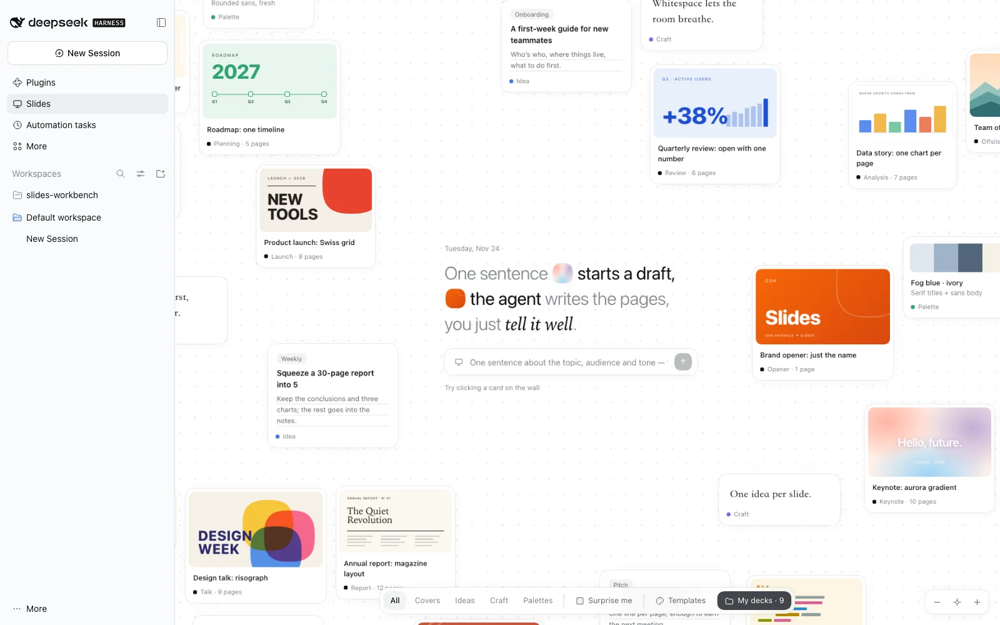
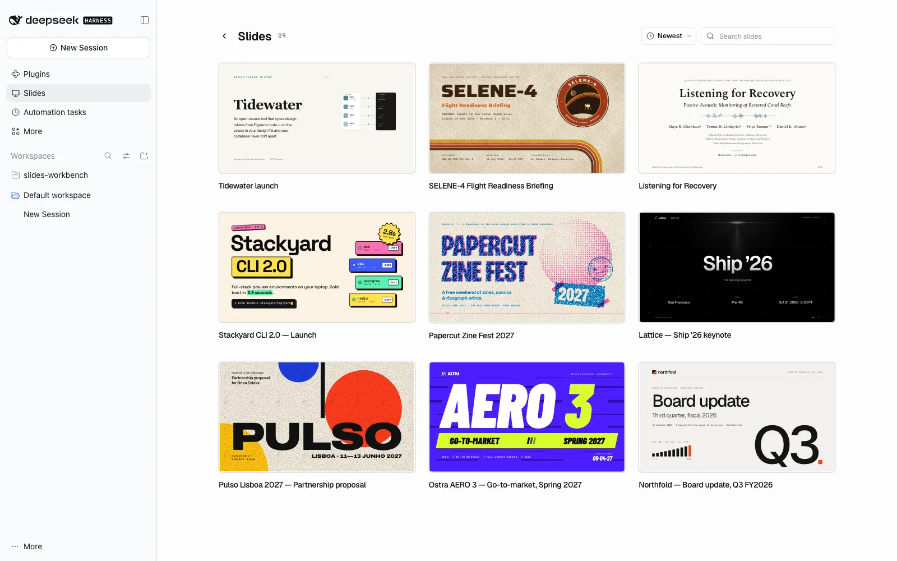
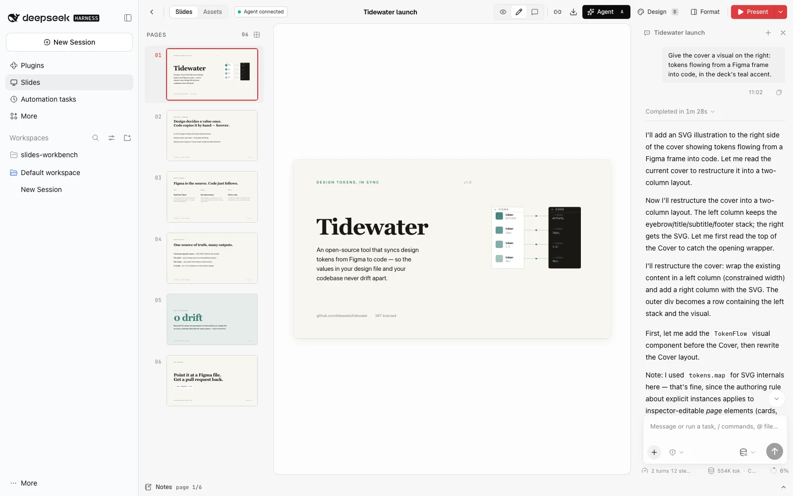

<p align="center">
  <picture>
    <source media="(prefers-color-scheme: dark)" srcset="docs/assets/home-dark.webp">
    
  </picture>
</p>

<h1 align="center">Slides Workbench</h1>

<p align="center"><b>A DeepSeek Harness plugin that brings <a href="https://open-slide.dev/docs">open-slide</a> into the sidebar: describe a deck, the agent writes the pages, and you preview, edit, present, and export them in place.</b></p>

<p align="center">
  <a href="#install">Install</a> ·
  <a href="#faq">FAQ</a> ·
  <a href="#development">Development</a> ·
  <a href="README.zh-CN.md">简体中文</a>
</p>

<br>

## Overview

The workbench is a home page plus open-slide's own editor, embedded in a DSH panel. Submit a request on the home page and the workbench creates a deck, opens the editor, and sends the request to the editor's Agent panel, which runs a native DSH conversation. The agent writes the deck file and the editor reloads as it goes.

Decks are plain files in a standard open-slide workspace (`$DSH_HOME/slides-workbench` by default), so you can edit them by hand or keep them in git. The workbench follows the DSH theme and language.

<br>

## Home

<table>
<tr>
<td valign="top" width="38%">
<p><b>Cards fill the prompt</b></p>
<p>Click a cover or idea card to put its text in the input. Craft and palette cards are appended as style requirements; press Backspace to remove the last one.</p>
<p><b>One step to a deck</b></p>
<p>Submitting creates a deck, opens the editor with the Agent panel open, and sends the request as the first message of that deck's conversation.</p>
<p><b>My decks and templates</b></p>
<p>The dock filters cards, picks one at random, and opens open-slide's deck list or theme gallery. A theme page gets a <i>Use this template</i> button that attaches the theme to your next request.</p>
</td>
<td>
  <picture>
    <source media="(prefers-color-scheme: dark)" srcset="docs/assets/decks-dark.webp">
    
  </picture>
</td>
</tr>
</table>

<br>

## Editor

<table>
<tr>
<td width="62%">
  <picture>
    <source media="(prefers-color-scheme: dark)" srcset="docs/assets/editor-dark.webp">
    
  </picture>
</td>
<td valign="top">
<p><b>Edit</b></p>
<p>open-slide's editor, unchanged: page thumbnails, canvas, Format and Design panels, comments, assets, and speaker notes.</p>
<p><b>Agent panel</b></p>
<p>The <i>Agent</i> button (or <kbd>A</kbd>) opens open-slide's right dock; its content is a native DSH conversation, one per deck. Streaming, tool calls, approvals, model selection, and context usage all come from DSH.</p>
<p><b>Present and export</b></p>
<p><i>Present</i> opens full-screen mode with a presenter view. The export menu produces HTML, PDF, and PPTX.</p>
</td>
</tr>
</table>

<br>

## Install

**1. Add the plugin**

In DeepSeek Harness, open **Plugins** and install this package, or ask the agent:

```
plugin_manager install_bundle  →  target: <absolute path to this repo>
```

**2. First run**

A **Slides** entry appears in the sidebar. On activation the plugin creates the workspace and installs `@open-slide/core`; the panel shows progress and opens the home page when done.

Requires Node.js 20+ and a reachable npm registry for the first install. Dependencies live in the workspace's `node_modules`; your projects are not touched.

<br>

## Configuration

Set in the plugin entry of the profile's `cordis.patch.yml`:

```yaml
- id: slides-workbench
  config:
    workspace: ~/Documents/decks   # default: $DSH_HOME/slides-workbench
    port: 5173                     # first port tried for the open-slide dev server
```

Workspace layout:

| Path | Content |
| --- | --- |
| `slides/<id>/index.tsx` | Deck source |
| `slides/<id>/assets/` | Images, video, and fonts for one deck |
| `themes/` | Shared design systems, including 11 bundled templates |
| `dist/` | Static site from a build |
| `.trash/` | Deleted decks, recoverable by hand |

<br>

## FAQ

<details>
<summary><b>What can the agent do?</b></summary>
<br>

Conversations in the Agent panel use the bundled `slides-workbench` agent preset: the DSH `standard` preset plus five open-slide skills — `create-slide`, `slide-authoring`, `create-theme`, `apply-comments`, and `current-slide`. The session's working directory is the workspace, and the agent edits `slides/<id>/index.tsx` with ordinary file tools. The skills are scoped to this preset and do not appear in other DSH sessions.

</details>

<details>
<summary><b>Where do the conversations live?</b></summary>
<br>

Each deck has its own DSH session, titled after the deck and grouped under the `slides-workbench` workspace, so it also shows up in the DSH sidebar and search. The <b>+</b> button in the panel header starts a new conversation for the current deck.

</details>

<details>
<summary><b>Will bundled templates overwrite my changes?</b></summary>
<br>

No. Bundled templates are merged into `themes/` on startup and when the template page opens. Templates you edited or deleted, and local templates with the same name, are left alone and no longer synced. The merge record is `themes/.official.json`.

</details>

<details>
<summary><b>The panel is stuck on installing, or the preview fails to start</b></summary>
<br>

Dependencies install with `npm ci` from `template/package-lock.public.json`, trying npmmirror and then npmjs. On failure the panel shows <i>Retry</i> and the full install log. The dev server listens on `localhost` only; if the port is taken it moves to the next free one.

</details>

<details>
<summary><b>Can I use the workspace without DSH?</b></summary>
<br>

Yes. Run `npm run dev` in the workspace and open <http://localhost:5173/slides-workbench/app/>. The `base` path in `open-slide.config.ts` is managed by the workbench, so do not edit it; builds temporarily reset it to `/`, so `dist/` deploys to any static host root.

</details>

<details>
<summary><b>Does it work with remote DSH?</b></summary>
<br>

Yes. The panel loads open-slide through a same-origin reverse proxy on the DSH host (including HMR), so a remote client sees the same page. The dev server itself stays on the host's `localhost`.

</details>

<br>

## Development

```bash
npm install
npm run build      # bundle the client into dist/client.js
npm run watch      # rebuild on change
npm test           # unit tests
```

| Directory | Content |
| --- | --- |
| `src/` | Host side: workspace and dev server management, reverse proxy, official theme sync |
| `client/` | Panel UI (React): loading, home page, editor frame, Agent panel |
| `skills/` | open-slide skills used by the agent preset (upstream diff in `skills/README.md`) |
| `template/` | Workspace template and lockfile |
| `themes/` | Bundled templates (`<id>.md` + `<id>.demo.tsx`) |
| `cordis.patch.yml` | Plugin entry and the `slides-workbench` agent preset |

<br>

<p align="center"><sub><a href="LICENSE">MIT</a> · Editor, runtime, and skills by <a href="https://open-slide.dev">open-slide</a> (MIT, © Yiwei Ho)</sub></p>
