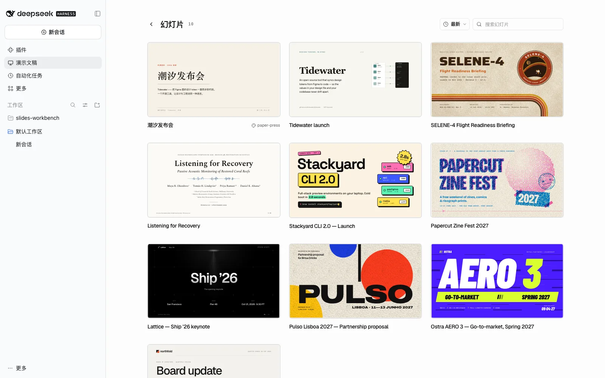
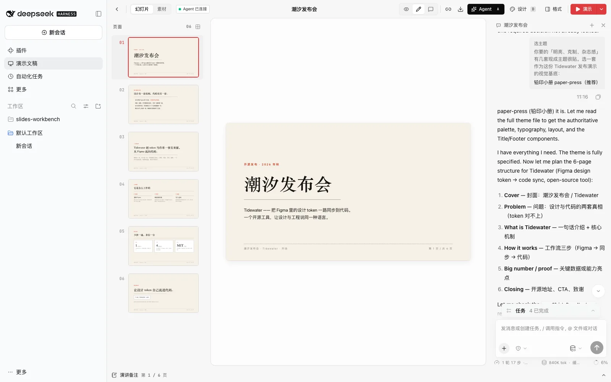

<p align="center">
  <picture>
    <source media="(prefers-color-scheme: dark)" srcset="docs/assets/home-dark.zh-CN.webp">
    
  </picture>
</p>

<h1 align="center">演示文稿工作台</h1>

<p align="center"><b>DeepSeek Harness 插件：把 <a href="https://open-slide.dev/docs">open-slide</a> 搬进侧栏。说出需求，由 AI 生成页面，在面板内预览、编辑、演示和导出。</b></p>

<p align="center">
  <a href="#安装">安装</a> ·
  <a href="#问答">问答</a> ·
  <a href="#开发">开发</a> ·
  <a href="README.md">English</a>
</p>

<br>

## 概述

工作台由首页和 open-slide 自带的编辑器组成，嵌在 DSH 的面板里。在首页提交需求后，工作台新建 deck、打开编辑器，并把需求发给编辑器的 Agent 面板——面板内容是 DSH 原生对话。AI 写入 deck 文件，编辑器同步刷新。

deck 以文件形式保存在标准的 open-slide 工作区（默认 `$DSH_HOME/slides-workbench`），支持手动修改和 git 管理。界面跟随 DSH 的主题与语言设置。

<br>

## 首页

<table>
<tr>
<td valign="top" width="38%">
<p><b>卡片填充需求</b></p>
<p>点击封面卡或想法卡，内容填入输入框；心法卡和配色卡作为风格要求追加在需求之后，按退格键移除最后一项。</p>
<p><b>一步建好 deck</b></p>
<p>提交后新建 deck，打开编辑器并展开 Agent 面板，需求作为这个 deck 对话的第一条消息发出。</p>
<p><b>我的演示与模板</b></p>
<p>底部栏可按类型筛选卡片、随机挑一张，或进入 open-slide 的 deck 列表和主题页。模板详情页多一个「用这个模板」，把主题叠加到下一次需求上。</p>
</td>
<td>
  <picture>
    <source media="(prefers-color-scheme: dark)" srcset="docs/assets/decks-dark.zh-CN.webp">
    
  </picture>
</td>
</tr>
</table>

<br>

## 编辑器

<table>
<tr>
<td width="62%">
  <picture>
    <source media="(prefers-color-scheme: dark)" srcset="docs/assets/editor-dark.zh-CN.webp">
    
  </picture>
</td>
<td valign="top">
<p><b>编辑</b></p>
<p>open-slide 编辑器原样保留：页面缩略图、画布、格式与设计面板、批注、素材和演讲备注。</p>
<p><b>Agent 面板</b></p>
<p>工具栏的 <i>Agent</i> 按钮（或按 <kbd>A</kbd>）打开 open-slide 的右侧面板，内容换成 DSH 原生对话，每个 deck 一段。流式输出、工具调用、审批、模型选择和上下文用量都由 DSH 提供。</p>
<p><b>演示与导出</b></p>
<p><i>演示</i>进入全屏，支持演讲者视图；导出菜单支持 HTML、PDF 和 PPTX。</p>
</td>
</tr>
</table>

<br>

## 安装

**1. 添加插件**

在 DeepSeek Harness 的「插件」页安装本包，或让 AI 执行：

```
plugin_manager install_bundle  →  target: <本仓库的绝对路径>
```

**2. 首次启动**

侧栏出现「演示文稿」入口。插件激活时自动创建工作区并安装 `@open-slide/core`，面板显示进度，完成后进入首页。

首次安装要求本机有 Node.js 20+ 和可用的 npm 源。依赖装在工作区的 `node_modules`，不影响你的项目目录。

<br>

## 配置

在 profile 的 `cordis.patch.yml` 中设置插件条目：

```yaml
- id: slides-workbench
  config:
    workspace: ~/Documents/decks   # 默认 $DSH_HOME/slides-workbench
    port: 5173                     # open-slide dev server 的起始端口
```

工作区结构：

| 路径 | 内容 |
| --- | --- |
| `slides/<id>/index.tsx` | deck 源码 |
| `slides/<id>/assets/` | 单个 deck 的图片、视频和字体 |
| `themes/` | 跨 deck 复用的设计系统，含 11 套内置模板 |
| `dist/` | 构建产出的静态站 |
| `.trash/` | 已删除的 deck，可手动恢复 |

<br>

## 问答

<details>
<summary><b>AI 有哪些能力？</b></summary>
<br>

Agent 面板中的对话使用插件自带的 `slides-workbench` agent preset：DSH `standard` 预设加上 5 个 open-slide 技能——`create-slide`、`slide-authoring`、`create-theme`、`apply-comments`、`current-slide`。会话工作目录就是工作区，AI 用普通文件工具编辑 `slides/<id>/index.tsx`。这些技能只在该 preset 中可见，不出现在其他 DSH 会话里。

</details>

<details>
<summary><b>对话保存在哪里？</b></summary>
<br>

每个 deck 对应一段 DSH 会话，以 deck 标题命名，归在 `slides-workbench` 工作区下，在 DSH 侧栏和搜索中同样可见。面板标题栏的 <b>+</b> 为当前 deck 开启新对话。

</details>

<details>
<summary><b>内置模板会覆盖我改过的模板吗？</b></summary>
<br>

不会。内置模板在启动时和打开模板页时合并进 `themes/`：改过或删除的模板、与内置同名的本地模板都不会被覆盖，此后也不再同步。合并记录保存在 `themes/.official.json`。

</details>

<details>
<summary><b>一直显示安装中，或预览无法启动</b></summary>
<br>

依赖按 `template/package-lock.public.json` 用 `npm ci` 安装，依次尝试 npmmirror 和 npmjs。失败时面板提供「重试」和完整安装日志。dev server 只监听 `localhost`，端口被占用时自动顺延。

</details>

<details>
<summary><b>能脱离 DSH 使用工作区吗？</b></summary>
<br>

可以。在工作区执行 `npm run dev`，打开 <http://localhost:5173/slides-workbench/app/>。`open-slide.config.ts` 中的 `base` 由工作台维护，请勿手改；构建时会临时改回 `/`，因此 `dist/` 可部署到任意静态托管的根路径。

</details>

<details>
<summary><b>远程访问 DSH 时可用吗？</b></summary>
<br>

可用。面板通过 DSH 主机上的同源反向代理加载 open-slide（含 HMR），远程客户端看到的是同一个页面；dev server 仍只运行在主机的 `localhost` 上。

</details>

<br>

## 开发

```bash
npm install
npm run build      # 打包 client 到 dist/client.js
npm run watch      # 监听改动并重新打包
npm test           # 单元测试
```

| 目录 | 内容 |
| --- | --- |
| `src/` | Host 侧：工作区与 dev server 管理、反向代理、内置模板同步 |
| `client/` | 面板界面（React）：加载页、首页、编辑器容器、Agent 面板 |
| `skills/` | agent preset 使用的 open-slide 技能（与上游的差异见 `skills/README.md`） |
| `template/` | 工作区模板与锁文件 |
| `themes/` | 内置模板（`<id>.md` + `<id>.demo.tsx`） |
| `cordis.patch.yml` | 插件条目与 `slides-workbench` agent preset |

<br>

<p align="center"><sub><a href="LICENSE">MIT</a> · 编辑器、运行时与技能基于 <a href="https://open-slide.dev">open-slide</a>（MIT，© Yiwei Ho）</sub></p>
